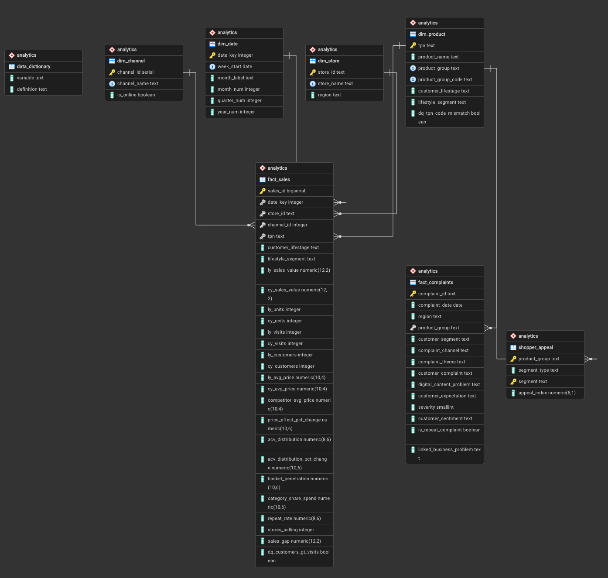

# Retail Revenue Analysis (SQL / PostgreSQL)

Module: Applied AI in Business Analytics
Tools: PostgreSQL 16, pgAdmin 4, Python (pandas), Excel

This project analyses 1,800 weekly retail records (£2.48M current revenue) across 10 stores, 10 product groups and 3 sales channels. The aim was to explain an 8.5% year-on-year fall in revenue and recommend an action.

All work is done in SQL: loading the raw data, checking its quality, cleaning it into a star schema, then ranking performance and analysing the causes of the decline. The output of every script is saved in the `results/` folder.

## Key findings

| Finding | Script |
|---|---|
| Revenue fell 8.5% year on year, from £2.71M to £2.48M (−£231.6K). Units fell 12.8% and customers fell 5.3%. | `05_kpi_overview` |
| The fall came from physical stores (−16.3%). Online sales grew 6.0% (Click & Collect +7.2%, Online Delivery +4.9%). | `08_channel_ranking` |
| Four product groups lost £310.8K between them. The growing groups made back £79.2K. | `07_product_group_ranking` |
| The weakest line was Everyday 2 Litre Tubs at −36.3%, with units down 40.7% and customers down 22.7%. | `07`, `10` |
| Best store: Norwich Riverside (+7.7%). Worst: Peterborough Retail Park (−26.9%, −£97.5K). | `06_store_ranking` |
| Price was the main driver. Product groups priced further above the main competitor declined more (correlation of −0.97). Tubs went from 3.6% to 10.8% above the competitor's price. | `09_decline_drivers` |
| Within Tubs, the records with the highest price premium lost 48% of units, compared with 18% for the lowest. | `10_weakest_product_deep_dive` |
| The declining lines appeal most to Kids Choice, Price Sensitive and Young Families shoppers, the groups most likely to react to price. | `11_shopper_profile_analysis` |

**Recommendation:** bring the price of Everyday 2 Litre Tubs closer to the competitor's price and aim the relaunch at young families. As a rough scenario, matching the competitor's price and winning back half the lost units would add around £32.7K in revenue.

## Database design

The raw data is first loaded into a `staging` schema with every column stored as text, so the load never fails on bad values. It is then cleaned, typed and loaded into an `analytics` schema built as a star schema.



- `fact_sales`: one row per week, store, channel and product (1,800 rows)
- `dim_date`, `dim_store`, `dim_channel`, `dim_product`: dimension tables
- `shopper_appeal`: shopper appeal index by product group and segment
- `fact_complaints`: 600 customer complaints from the second dataset

## Scripts

Run in order:

| # | Script | Purpose |
|---|---|---|
| 00 | `00_create_database.sql` | Create the `retail_analytics` database |
| 01 | `01_create_staging_tables.sql` | Create raw staging tables |
| 02 | `02_load_data.sql` | Load the data (INSERT statements, runs in pgAdmin) |
| 02b | `02b_load_data_psql_copy.sql` | Alternative load using `\copy` in psql |
| 03 | `03_data_quality_checks.sql` | Nulls, duplicates, data types, ranges, logic checks |
| 04 | `04_clean_transform.sql` | Clean the data, build the star schema, reconcile totals |
| 05 | `05_kpi_overview.sql` | Headline KPIs and monthly trend |
| 06 | `06_store_ranking.sql` | Best and worst stores |
| 07 | `07_product_group_ranking.sql` | Best and worst product groups |
| 08 | `08_channel_ranking.sql` | Channel performance |
| 09 | `09_decline_drivers.sql` | Price vs volume breakdown, competitor pricing |
| 10 | `10_weakest_product_deep_dive.sql` | Deep dive into the weakest product line |
| 11 | `11_shopper_profile_analysis.sql` | Which shoppers buy the declining products |
| 12 | `12_customer_complaints_analysis.sql` | Complaint themes and severity |
| 13 | `13_validate_ai_findings.sql` | Check figures from an AI-generated analysis against SQL |

## How to run

**pgAdmin:** create a database called `retail_analytics`, then open each script in the Query Tool in order and press F5. See [docs/pgadmin_step_by_step.md](docs/pgadmin_step_by_step.md).

**psql (from the project folder):**
```bash
psql -U postgres -d postgres -f sql/00_create_database.sql
psql -U postgres -d retail_analytics -f sql/run_all.sql
```

To rebuild the CSV and load files from the original Excel workbooks:
```bash
pip install -r requirements.txt
python scripts/export_excel_to_csv.py
python scripts/generate_insert_sql.py
```

## SQL used

- **Modelling:** schemas, primary and foreign keys, unique and check constraints, generated columns, indexes
- **Cleaning:** `TRIM`, `UPPER`, `NULLIF`, regex validation, `TO_DATE`, type casting, unpivoting with `CROSS JOIN LATERAL`, `MODE() WITHIN GROUP`
- **Analysis:** CTEs, window functions (`RANK`, `ROW_NUMBER`, `NTILE`, `LAG`, `FIRST_VALUE`, running totals), conditional aggregation with `FILTER`, `CORR`, `REGR_SLOPE`, views

## Data quality notes

The dataset had no missing values or duplicates, and the calculated columns matched their source columns. Two issues were found and flagged rather than deleted:

- 5 rows show more unique customers than shopping visits, which isn't possible. These are flagged in `fact_sales.dq_customers_gt_visits`.
- 5 product codes (TPNs) contain a different code from their product group. These are flagged in `dim_product.dq_tpn_code_mismatch`.

Competitor price comparisons are weighted by units sold, so they compare like with like against the company's average selling price.

## Checking the AI analysis

The same dataset was also analysed with a generative AI tool. Script 13 compares the AI's figures and rankings with the SQL results and marks each one as AGREES or DIFFERS, so the AI output is checked before it's relied on.
